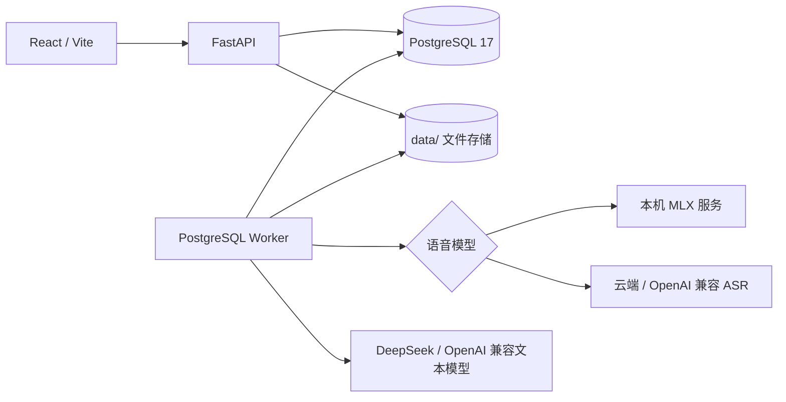

# LC ASR Pipeline

面向内网部署的多租户录音转写平台。系统以 PostgreSQL 保存账户、模型配置、上传记录、任务状态和转写结果，由独立 Worker 串联语音识别、说话人分离和文本整理；前端提供租户工作台与超级管理员控制台。

本项目没有公开注册入口。超级管理员负责创建组织和账户，租户之间默认严格隔离；标记为“公开”的转写任务可被其他已登录用户查看。

## 已实现功能

- 超级管理员登录、强制首次改密、组织及账户创建、禁用、删除和密码重置。
- 新账户使用随机初始密码，首次登录后必须修改密码并重新登录。
- 租户级数据隔离，以及公开/私有转写任务。
- 语音模型和文本模型配置、加密保存凭据、连接测试及模型发现。
- 模型软删除：历史任务仍可显示，已删除模型以删除线和状态提示标识。
- 本地 MLX Qwen3-ASR、StepFun 及 OpenAI 兼容语音接口。
- DeepSeek 及 OpenAI 兼容文本整理接口。
- 分片、断点续传和批量上传，单批次上限为 5 GiB。
- ZIP/TAR 安全解包、SHA-256 去重、任务重试/取消/重新转写。
- 时间戳、说话人分离、左右对话布局和关键词/专业术语整理。
- TXT、JSON、SRT、VTT、HTML 导出。
- 管理员查看全部租户的任务、转写内容与原始录音，并发起重新转写。
- PostgreSQL Worker 任务抢占、心跳、异常恢复和模型配置快照。
- 两阶段持久化：ASR 完成后立即保存原始文本、时间戳和说话人提示；文本整理失败时只重试文本模型。

## 系统结构



应用服务和模型服务是两个独立运行边界：

| 组件 | 环境 | 默认地址 | 说明 |
| --- | --- | --- | --- |
| FastAPI + Worker | `lc-asr-pipeline`，Python 3.10 | `127.0.0.1:8000` | API、认证、任务编排和后台消费 |
| React / Vite | Node.js + npm | `127.0.0.1:5173` | 用户工作台和管理员控制台 |
| PostgreSQL | PostgreSQL 17 | `127.0.0.1:5432` | 业务数据、任务队列和迁移记录 |
| MLX 模型服务（可选） | `lc-asr-model`，Python 3.12 | `127.0.0.1:8765` | Apple Silicon 上的本地 ASR、时间戳和说话人分离 |

不使用本地语音模型时，无需启动 MLX 模型服务；可以直接配置云端语音 Provider。

## 环境要求

- macOS Apple Silicon：仅在使用本地 MLX/Metal 推理时需要。
- Conda。
- Python 3.10（已验证版本为 3.10.20）。
- PostgreSQL 17。
- Node.js 和 npm。
- FFmpeg：音频探测、转换和模型处理需要。

应用的核心版本固定在 [pyproject.toml](pyproject.toml)；[requirements.txt](requirements.txt) 是当前 `osx-arm64` Conda 环境的精确导出，不是跨平台锁文件。

## 快速开始

### 1. 安装应用环境

```sh
conda create -n lc-asr-pipeline python=3.10.20 -y
conda activate lc-asr-pipeline
python -m pip install -e '.[dev]'

cd frontend
npm ci
cd ..
```

安装后建议检查依赖一致性：

```sh
python -m pip check
```

### 2. 准备 PostgreSQL

在 PostgreSQL 17 中创建专用数据库和最小权限账户。项目不会自动创建数据库，也不要在命令、日志或 README 中保存真实密码。

### 3. 配置环境变量

```sh
cp .env.example .env
chmod 600 .env
```

至少修改以下配置：

- `POSTGRES_*`：PostgreSQL 连接信息。
- `AUTH_SECRET_KEY`：足够长的随机认证密钥。
- `MLX_ASR_API_KEY`：使用本地模型服务时，为应用与模型服务配置相同的随机密钥。
- `PYANNOTE_AUTH_TOKEN`：使用 pyannote Community-1 时配置只读 Hugging Face Token。

`.env`、模型凭据、API Key、录音和转写内容均不得提交到版本库。生产模式会拒绝示例中的默认认证密钥。

### 4. 执行数据库迁移

```sh
python -m lc_asr_pipeline.db.migrate
```

迁移按文件名顺序执行，使用校验和和 PostgreSQL advisory lock 防止迁移被篡改或并发执行。不要直接使用 `schema/pg_schema.sql` 初始化或升级数据库：它只是当前 PostgreSQL 17 表和索引的可读快照，正式结构演进必须新增不可变迁移文件。

### 5. 启动应用

```sh
./dev.sh start
./dev.sh status
```

`dev.sh` 会启动 FastAPI、Worker 和 Vite，但不会启动本地模型服务。

打开：

- Web：<http://127.0.0.1:5173>
- API 文档：<http://127.0.0.1:8000/docs>
- 存活检查：<http://127.0.0.1:8000/api/v1/health/live>
- 就绪检查：<http://127.0.0.1:8000/api/v1/health/ready>

查看日志或停止服务：

```sh
./dev.sh logs
./dev.sh stop
```

日志写入 `logs/backend.log`、`logs/worker.log`、`logs/frontend.log` 和 `logs/dev.log`。

## 首次管理员登录

迁移会创建用于首次引导的超级管理员：

```text
用户名：root
初始密码：root
```

登录页的“管理员登录”进入超级管理员流程。首次登录后系统会强制修改密码，修改完成后必须重新登录。`root/root` 仅用于首次引导，部署后应立即替换，不能作为正式环境凭据。

超级管理员可以：

- 创建组织及租户账户，系统为新账户生成随机初始密码。
- 禁用账户、删除租户、重置用户密码。
- 查看全部租户的任务、转写结果、账户信息和原始录音。
- 使用已有模型方案对录音重新发起转写。

删除租户会删除其转写任务和业务归属记录，但保留原始录音文件。涉及删除前应先确认保留策略并做好数据库备份。

普通用户首次使用随机密码登录时，同样必须修改密码并重新登录。之后主动改密需要提交原密码。密码规则为：

- 至少 8 位；
- 不能与用户名或登录标识相同；
- 包含大小写字母，或者包含特殊字符，满足其中一种即可。

## 可选：本地 MLX 模型服务

本地模型服务必须在 macOS 原生环境运行。Docker Desktop 中的 Linux 容器无法使用 macOS Metal，因此不能承载此 MLX 运行时。

### 已验证硬件与资源占用

以下数据来自 2026-07-22 至 2026-07-23 的本机验证，不是厂商理论值：

| 项目 | 测试配置 |
| --- | --- |
| 设备 | MacBook Pro（Mac17,6） |
| 芯片 | Apple M5 Max |
| CPU / GPU | 18 核 CPU、40 核 GPU |
| 内存 | 128 GiB 统一内存 |
| 图形计算 | Metal 4，原生 arm64 macOS |
| 应用环境 | Python 3.10.20 |
| 模型环境 | Python 3.12.13、MLX 0.32.0、`mlx-qwen3-asr` 0.3.5、`pyannote.audio` 4.0.7 |

本机 `model/` 目录的磁盘占用统计如下。数值来自 macOS `du`，表示文件系统实际占用，可能因文件系统和模型版本略有差异：

| 本地资产 | 磁盘占用 | 运行时用途 |
| --- | ---: | --- |
| Qwen3-ASR-1.7B 8-bit MLX | 2.33 GiB | 语音识别 |
| Qwen3 Forced Aligner 0.6B | 1.71 GiB | 词/片段时间戳对齐 |
| pyannote Community-1 | 32.2 MiB | 可选说话人分离 |
| **实际推理资产合计** | **约 4.08 GiB** | 模型服务需要保留的主要资产 |
| Qwen3-ASR-1.7B 源模型 | 4.38 GiB | 下载和转换来源，8-bit 推理时不加载 |
| **当前 `model/` 目录总计** | **约 8.46 GiB** | 包含推理资产、源模型及少量缓存 |

运行内存与速度的已记录结果：

| 测试 | 音频时长 | 流程 | 耗时 | RTF | 峰值内存 |
| --- | ---: | --- | ---: | ---: | ---: |
| 短中文样本 | 约 5.6 秒 | 8-bit ASR + 强制对齐 | 约 3.16 秒 | 约 0.57 | 约 4.31 GiB RSS |
| 双人中文样本 | 22.33 秒 | ASR + 强制对齐 + 固定双人分离 | 8.18 秒 | 0.366 | 当次未记录 |
| 长录音 | 2969.94 秒 | ASR + 强制对齐 | 74.77 秒 | 0.0252 | 当次未记录 |
| 同一长录音 | 2969.94 秒 | ASR + 强制对齐 + 自动说话人分离 | 1332.49 秒 | 0.4487 | 当次未记录 |

`4.31 GiB` 是短样本测试期间记录的进程峰值常驻内存（RSS），不是模型文件大小，也不等同于整机统一内存峰值。长录音测试当时没有保存峰值内存数据，因此不在文档中推算。RTF 为处理时间除以音频时长，数值越低越快；短样本包含固定启动开销，模型热加载后的长音频 RTF 通常更低。实际资源消耗还会受音频长度、说话人数、是否启用 diarization、模型是否已经加载以及系统并发负载影响。

### 1. 创建模型环境

```sh
./scripts/model_bootstrap.sh
```

脚本创建 `lc-asr-model` Python 3.12 环境，并安装固定版本的 `mlx-qwen3-asr` 和 `pyannote.audio`。

### 2. 下载模型资产

```sh
conda run -n lc-asr-model python scripts/download_models.py --artifact ungated
```

需要说话人分离时，先在 Hugging Face 接受 pyannote Community-1 的使用条件，并在 `.env` 配置 `PYANNOTE_AUTH_TOKEN`：

```sh
conda run -n lc-asr-model python scripts/download_models.py --artifact pyannote
```

下载器会获取源 Qwen 模型、对齐模型和可选 pyannote 模型。服务使用的量化语音模型目录应准备为：

```text
model/qwen3-asr-1.7b-8bit/
```

仓库不提交模型权重，也没有把源模型转换为 8-bit 的自动脚本。完整目录约定见 [model/README.md](model/README.md) 和 [model/manifest.json](model/manifest.json)。

### 3. 检查并启动

```sh
conda run -n lc-asr-model python scripts/model_doctor.py --strict
./scripts/model_service.sh start
./scripts/model_service.sh status
```

模型服务只监听回环地址，并要求 Bearer Token。它提供 `/health`、`/v1/models` 和 OpenAI 兼容的 `/v1/audio/transcriptions`。查看日志或停止：

```sh
./scripts/model_service.sh logs
./scripts/model_service.sh stop
```

## 使用流程

1. 超级管理员登录 `/admin`，创建组织和用户，并安全地把一次性随机密码交给用户。
2. 用户登录并完成强制改密。
3. 在“模型”页面配置语音模型与文本模型，分别测试连接并选择发现到的模型。
4. 上传单个录音、多个文件或压缩包，创建转写任务并选择公开或私有。
5. Worker 执行 ASR 并立即保存检查点，任务进入 `refining`；随后使用文本模型进行对话拆分和校正。
6. 在任务或历史记录中查看左右对话、重新转写，或导出 TXT、JSON、SRT、VTT、HTML。

每个任务会保存模型配置快照。因此模型被删除后，已有任务和转写仍可查看，界面会提示模型已删除；新任务不能继续选择已删除的模型。

如果文本模型调用失败，任务会保留已经完成的 ASR 原始文本、时间戳和说话人提示。自动重试和页面上的“重试文本整理”都从该检查点继续，不会再次调用语音模型；只有 ASR 阶段本身失败时才重新执行语音解析。

## 常用开发命令

```sh
# 服务
./dev.sh start
./dev.sh status
./dev.sh logs
./dev.sh stop

# 后端测试与静态检查
pytest
ruff check src tests
mypy src
python -m pip check

# 前端检查
cd frontend
npm run lint
npm run build

# 迁移
cd ..
python -m lc_asr_pipeline.db.migrate

# 查看过期上传清理计划（默认只预览）
lc-asr-cleanup

# 确认后实际清理
lc-asr-cleanup --apply
```

也可以使用安装后提供的 `lc-asr-migrate` 和 `lc-asr-worker` 命令。浏览器回归测试需要额外的测试管理员凭据、测试音频和云端 Provider 配置，具体以 [frontend/package.json](frontend/package.json) 及 `scripts/` 下的测试脚本为准，切勿把这些凭据写入测试代码。

## 目录说明

```text
.
├── src/lc_asr_pipeline/   # FastAPI、认证、服务、数据库和 Worker
├── frontend/              # React、TypeScript、Vite、RetroUI 风格界面
├── model_service/         # 本地 MLX OpenAI 兼容模型服务
├── scripts/               # 模型、健康检查、冒烟测试和运维脚本
├── migrations/            # 有序且不可变的 PostgreSQL 迁移
├── schema/pg_schema.sql   # 当前数据库结构的可读快照
├── tests/                 # pytest 单元与集成测试
├── model/                 # 本地模型资产（大文件不入库）
├── data/                  # 上传、转写和测试数据（不入库）
├── logs/                  # 本地服务日志（不入库）
└── llm-repo/              # 项目状态、证据、知识页和阶段计划
```

## 数据与安全边界

- 用户数据查询必须带租户边界；只有超级管理员路由可跨租户查看。
- 模型 Provider 密钥使用由应用根密钥派生的 AES-GCM 密钥加密保存，不在 API 响应或日志中返回明文。
- Access Token 为短期令牌，Refresh Token 使用 HttpOnly Cookie 并支持轮换。
- 上传文件按 SHA-256 去重；归档解包会校验路径穿越和体积边界。
- 应用、本地模型和数据库默认使用回环地址。对外部署时应放在受控反向代理之后并启用 TLS。
- `data/` 中可能包含原始录音和敏感转写；数据库备份与文件备份必须采用相同的访问控制和保留策略。
- 禁止提交 `.env`、真实 API Key、数据库密码、个人信息、录音、转写和模型权重。

## 数据库变更约定

1. 在 `migrations/` 新增下一个编号的 SQL 文件，已应用文件不可修改。
2. 同步更新 `schema/pg_schema.sql`，使其反映迁移后的 PostgreSQL 17 结构。
3. 执行迁移并至少完成 PostgreSQL `SELECT 1`、相关 pytest、前端检查和 `python -m pip check`。
4. 数据库迁移会记录文件名和 SHA-256 校验和；校验和不一致会中止启动。

## 当前边界

工作台中的 Agent、成员、角色和部分设置入口仍属于后续扩展，不应视为完整的 RBAC 或 Agent 管理功能。当前权限模型以平台超级管理员、租户账户、租户隔离及任务公开性为主。

更详细的当前实现状态见 [llm-repo/wiki/lc-asr-pipeline-status.md](llm-repo/wiki/lc-asr-pipeline-status.md)，阶段规划见 [llm-repo/fplan.md](llm-repo/fplan.md)。
